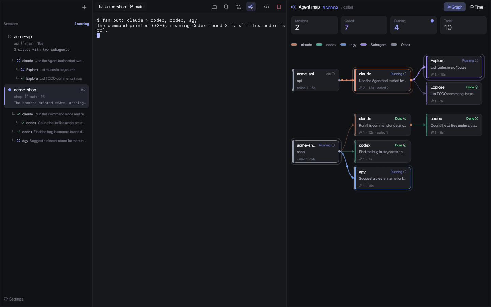
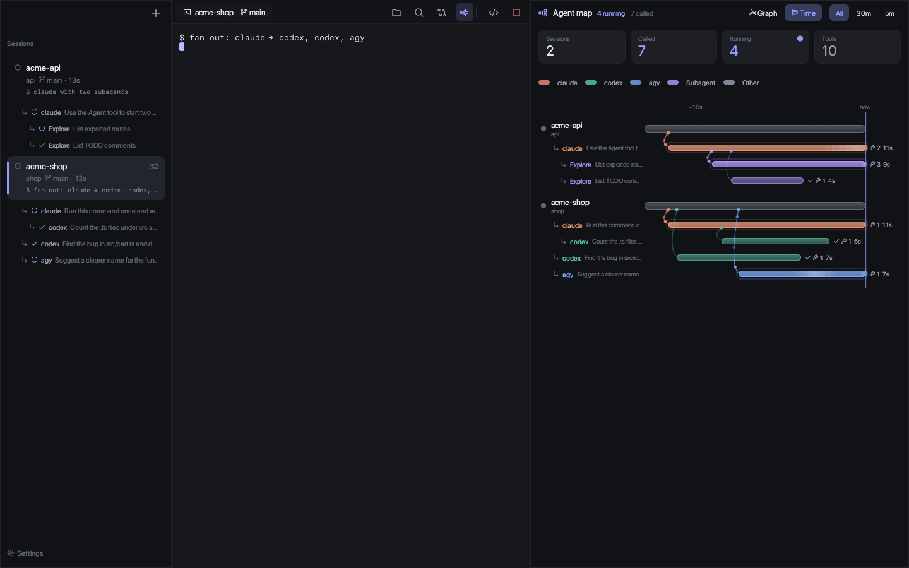
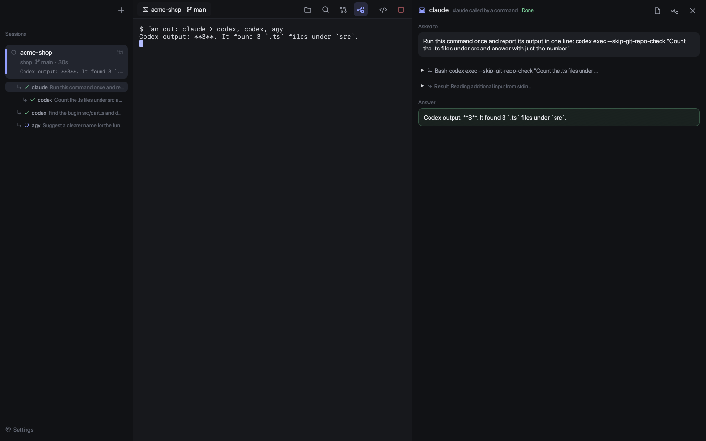

<div align="center">

# Paibot Agents

**コーディングエージェントを並べて動かし、どのエージェントがどれを呼んだかを見る。**

Claude Code・Codex・Antigravity のための、macOS のデスクトップアプリ。
エージェントが別のエージェントに仕事を回すと、その呼び出しのツリーを、会社をまたいでその場で描きます。

[English](README.md) · 日本語

<br>



</div>

---

## なぜ

いまのエージェントは、ほかのエージェントを呼びます。claude が `codex exec` を走らせたり、`Explore` の子エージェントを立てたり、`agy` に画像を作らせたり。でも、それぞれの道具は自分の分しか見せてくれません。Paibot Agents は、各エージェントが手元に書いている記録を読んで、**1本のツリー**にまとめます。誰が誰を呼び、何を頼まれ、何をして、何と答えたかが分かります。

<table>
<tr>
<td width="50%"></td>
<td width="50%"></td>
</tr>
<tr>
<td align="center"><sub><b>時間</b> — いつ呼ばれ、どれだけ動いたか</sub></td>
<td align="center"><sub><b>中身</b> — 頼まれたこと、使った道具、答え</sub></td>
</tr>
</table>

## できること

|  |  |
|---|---|
| 🕸 **エージェントマップ** <kbd>⌘G</kbd> | 全部のセッションと、そこから呼ばれたエージェントを、グラフか時間の流れで。何段でも。動いている呼び出しは光り、線の上を粒が流れる |
| 🔀 **会社をまたぐ** | Claude Code・Codex・Antigravity（`agy`）を1本のツリーに。claude の子エージェントや、agy 自身の子エージェントも |
| 🧷 **正直な線** | 実線は、記録に書いてある（または子への頼みごとそのものが親のコマンドに出てくる）つながり。点線は推測 |
| 🙅 **フックなし・読むだけ** | エージェントの設定には一切触らない。手元の記録を読むだけで、どこにも送らない |
| ⏯ **再開** | 閉じて開き直すと、会話の続きから戻る（`claude --resume`、`codex resume`） |
| 🌿 **worktree** | ブランチ名を入れるだけで、そのブランチの worktree でエージェントが始まる |
| ✍️ **編集して聞く** | ファイルをタブで開いて編集・保存。行を選んで <kbd>⌘L</kbd> で「`src/cart.ts` の 12〜20 行目: …」をエージェントの入力欄へ |
| 🗂 **VSCode のワークスペース** | `.code-workspace` を開くと、VSCode と同じくそのフォルダだけをエージェントに見せる（`--add-dir`）。VSCode・Cursor で最近開いたフォルダも並ぶ |
| 🔔 **待ちの検知** | 各セッションに「動作中 / 待っています / 静か」。手が空いたら macOS の通知 |
| 🌐 **日本語と English** | macOS の言語に合わせる。設定で選ぶこともできる |

## 呼び出しのツリーの作り方

| エージェント | 読む場所 | 親の見つけ方 |
|---|---|---|
| claude の子エージェント | `~/.claude/projects/<フォルダ>/<会話ID>/subagents/agent-*.jsonl` と `.meta.json` | 記録にある親の会話 ID（Paibot Agents が `--session-id` で決める）と、孫の `parentAgentId` |
| `claude -p` | `~/.claude/projects/<フォルダ>/*.jsonl`（`entrypoint: "sdk-cli"`） | 親のコマンドに子への頼みごとそのものがあれば実線、名前だけなら点線 |
| `codex exec` | `~/.codex/sessions/年/月/日/rollout-*.jsonl`（`source: "exec"`） | 同上 |
| `agy` | `~/.gemini/antigravity-cli/conversations/<ID>.db`（SQLite と protobuf。写しを取ってから読む） | 同上。agy 自身の子エージェントは、最初の知らせにある親の ID |

親のコマンドは、実際にそのエージェントを呼んだ回数の分しか子を引き受けません。並べて走らせた `codex exec` が、違う親に付くことを防ぎます。

## 入れる

```sh
cargo install --git https://github.com/paibot-hq/paibot-agents
paibot-agents
```

Dock から開きたいときは、アプリにまとめます。

```sh
git clone https://github.com/paibot-hq/paibot-agents && cd paibot-agents
sh scripts/bundle.sh ~/Applications   # → ~/Applications/Paibot Agents.app
```

> [!NOTE]
> まだ Apple の公証をしていません。ソースからビルドしたものは、警告なしで開けます。

### 使い方

```sh
paibot-agents                              # 今いるフォルダで、新しいセッションの画面が開く
paibot-agents ~/work/shop                  # フォルダを指定
paibot-agents ~/work/team.code-workspace   # VSCode のワークスペースから選ぶ
paibot-agents -a claude                    # 起動と同時に claude を1つ開く
```

初めて起動すると、入っているエージェント（claude、codex、gemini、cursor-agent、agy、opencode など）、プロジェクトの置き場、エディタを探す短い設定画面が出ます。

## スマホから頼む（paibot.app）

Paibot Agents は、[paibot.app](https://paibot.app/ja/bots) から仕事を受け取れます。Mac の側からつなぎに行ってつないだままにするので、Mac に外からの入口は開けません。

```sh
paibot-agents connect <鍵>   # paibot.app の「Bot」→「つなぐためのコマンドを作る」で出るコマンド
paibot-agents runner        # 画面を開かずに仕事だけ受けたいとき
```

Bot は `config.toml` にだけ書きます。paibot.app から頼めるのは、ここに書いたものだけです。

```toml
[[bots]]
name = "番人"
agent = "claude"              # claude | codex | agy | echo（echo は試し用。頼まれた文をそのまま返す）
folder = "~/work/shop"
note = "ショップを見張る"
args = ""                     # 足したい引数（claude の --allowedTools など）
```

頼まれた文は環境変数でエージェントに渡すので、シェルの命令として解釈されることはありません。つながっているかどうかは、サイドバーの下に出ます。

## キー

| キー | 動き | キー | 動き |
|---|---|---|---|
| <kbd>⌘N</kbd> | 新しいセッション | <kbd>⌘G</kbd> | エージェントマップ |
| <kbd>⌘O</kbd> | `.code-workspace` を開く | <kbd>⌘D</kbd> | 差分 |
| <kbd>⌘1</kbd>〜<kbd>⌘9</kbd> · <kbd>⌘[</kbd> <kbd>⌘]</kbd> | セッションを切り替え | <kbd>⌘E</kbd> | ファイルのツリー |
| <kbd>⌘P</kbd> | 名前でファイルを開く | <kbd>⌘⇧F</kbd> | 全体を検索 |
| <kbd>⌘L</kbd> | 選んだところをエージェントに聞く | <kbd>⌘S</kbd> | 保存 |
| <kbd>⌘J</kbd> | エディタの下のエージェントを出す／隠す | <kbd>⌘⌥←</kbd> <kbd>⌘⌥→</kbd> | タブを移る |
| <kbd>⌘W</kbd> | タブを閉じる（エージェントなら止める） | <kbd>⌘,</kbd> | 設定 |

⌘ が付かないキーは、すべてそのままエージェントのターミナルに届きます。

## 設定

`~/.config/paibot-agents/config.toml` にあります。ふつうは <kbd>⌘,</kbd> の設定画面で変えます。

<details>
<summary>全部の項目</summary>

```toml
language = "auto"             # auto | ja | en
project_roots = ["~/work"]    # この中のフォルダが新しいセッションの一覧に並ぶ
projects = []                 # 個別に並べたいフォルダ
workspaces = []               # 並べたい .code-workspace
vscode_recent = true          # VSCode・Cursor で最近開いたものも並べる
default_agent = "claude"
editor_app = "Visual Studio Code"
notify = true
font_size = 13.0
idle_secs = 2.0               # 出力がこの秒数止まったら「止まった」
min_busy_secs = 5.0           # 入力のあとこの秒数以上動いてから止まったら「待っています」

[[agents]]
name = "claude"
cmd = "claude"

[[agents]]
name = "codex"
cmd = "codex"

[[agents]]
name = "shell"
cmd = ""                      # 空ならログインシェル
```

</details>

## いまの状態

Paibot Agents はまだ若い道具です。Claude Code・Codex・Antigravity が公開していない記録の形式に頼っているので、どれかが更新されると、マップの一部が壊れることがあります。今は macOS だけで動きます。

<details>
<summary>開発</summary>

`cargo test` で、本物の擬似端末を使うものも含めたテストが走ります。

確認のために、Paibot Agents は自分の画面を書き出せます。

```sh
PAIBOT_AGENTS_SHOT=out.png PAIBOT_AGENTS_SHOT_SECS=4 PAIBOT_AGENTS_SHOT_UI=map paibot-agents -a shell
```

`PAIBOT_AGENTS_SHOT_UI` には `new | diff | files | setup | ask | quick | search | resume | child | map | timeline` を渡せます。
`PAIBOT_AGENTS_CONFIG_DIR` で設定の置き場を変えられます。

</details>

## ライセンス

MIT
