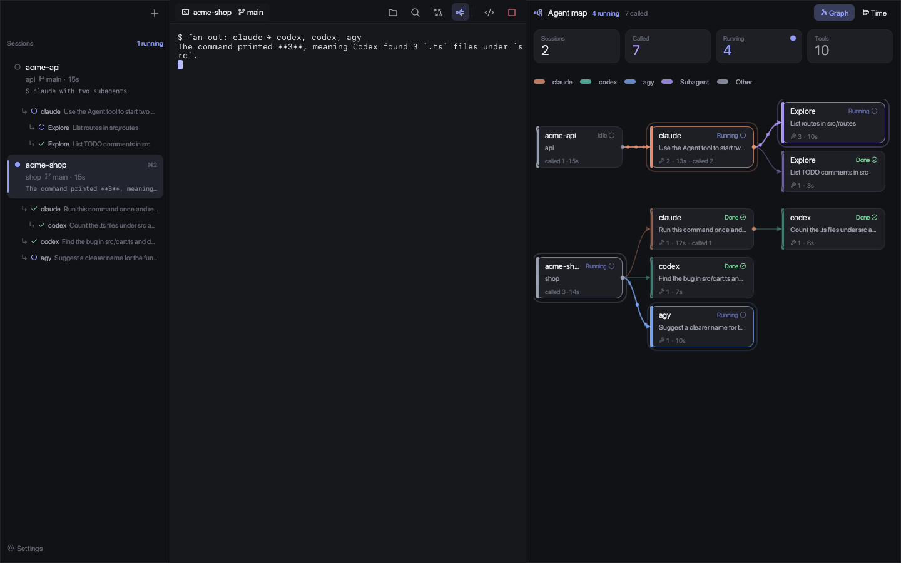
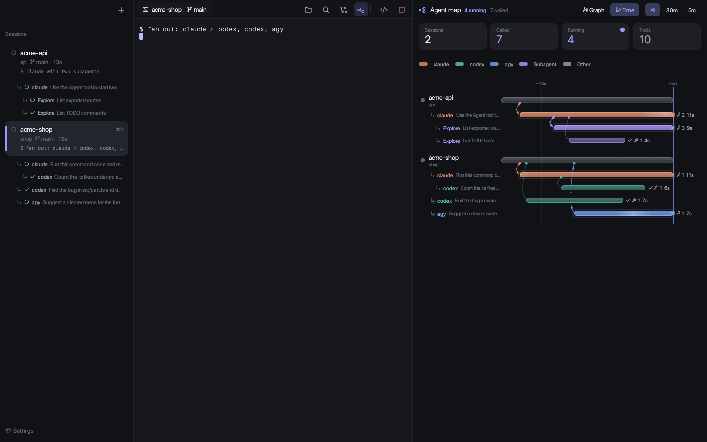
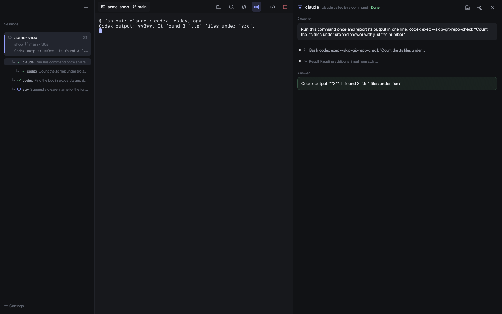

<div align="center">

# Paibot Agents

**Run coding agents side by side — and see which agent called which.**

A native macOS workspace for Claude Code, Codex and Antigravity.
When an agent hands work to another agent, Paibot Agents draws the call tree live, across vendors.


English · [日本語](README.ja.md)

<br>



</div>

---

## Why

Agents now call other agents. Claude shells out to `codex exec`, spawns `Explore` subagents, or asks `agy` to draw an image — and each tool only shows its own little piece. Paibot Agents reads the logs every agent already writes and stitches them into **one live tree**: who called whom, what they were asked, what they did, and what they answered.

<table>
<tr>
<td width="50%"></td>
<td width="50%"></td>
</tr>
<tr>
<td align="center"><sub><b>Timeline</b> — when each call started, how long it ran</sub></td>
<td align="center"><sub><b>Inspector</b> — the prompt, every tool call, the answer</sub></td>
</tr>
</table>

## Highlights

|  |  |
|---|---|
| 🕸 **Agent map** <kbd>⌘G</kbd> | Graph or timeline of every session and every agent it called — recursively. Running calls glow; particles flow along the edges. |
| 🔀 **Cross-vendor** | Claude Code, Codex and Antigravity (`agy`) in one tree, including Claude subagents and agy's own subagents. |
| 🧷 **Honest edges** | A solid line means the link is in the logs (or the child's exact prompt appears in the parent's command). A dashed line means it is a guess. |
| 🙅 **No hooks, read-only** | Paibot Agents never edits your agent settings. It only reads files the agents already write on your machine. Nothing is sent anywhere. |
| ⏯ **Resume** | Quit and come back: sessions reopen where the conversation left off (`claude --resume`, `codex resume`). |
| 🌿 **Worktrees** | Type a branch name and the agent starts in its own git worktree. |
| ✍️ **Edit & ask** | Open files in tabs, edit, save. Select lines and press <kbd>⌘L</kbd> to drop “`src/cart.ts` lines 12–20: …” into the agent's input. |
| 🗂 **VSCode workspaces** | Open a `.code-workspace` and the agent sees exactly those folders (`--add-dir`), just like VSCode. Recently opened VSCode / Cursor folders show up in the launcher. |
| 🔔 **Waiting detection** | Each session shows *running / waiting for you / idle*, with a macOS notification when an agent needs you. |
| 🌐 **English & 日本語** | Follows your macOS language, or pick one in Settings. |

## How the call tree is built

| Agent | Where Paibot Agents reads | How the parent is found |
|---|---|---|
| Claude subagent | `~/.claude/projects/<dir>/<session>/subagents/agent-*.jsonl` + `.meta.json` | Recorded: parent session ID (Paibot Agents picks it with `--session-id`) and `parentAgentId` for nested subagents |
| `claude -p` | `~/.claude/projects/<dir>/*.jsonl` with `entrypoint: "sdk-cli"` | The caller's command contains the child's exact prompt → solid. Only the name → dashed |
| `codex exec` | `~/.codex/sessions/YYYY/MM/DD/rollout-*.jsonl` with `source: "exec"` | Same as above |
| `agy` | `~/.gemini/antigravity-cli/conversations/<id>.db` (SQLite + protobuf, read from a snapshot) | Same as above; agy's own subagents are linked by the parent ID in their first message |

A caller's command can only be credited as many times as it actually invoked that agent, so two parallel `codex exec` calls do not get pinned on the wrong parent.

## Install

```sh
cargo install --git https://github.com/paibot-hq/paibot-agents
paibot-agents
```

Prefer the Dock? Build an app bundle:

```sh
git clone https://github.com/paibot-hq/paibot-agents && cd paibot-agents
sh scripts/bundle.sh ~/Applications   # → ~/Applications/Paibot Agents.app
```

> [!NOTE]
> The app is not notarized yet. A build from source runs without Gatekeeper warnings.

### Usage

```sh
paibot-agents                              # launcher opens with the current folder
paibot-agents ~/work/shop                  # start from a folder
paibot-agents ~/work/team.code-workspace   # pick from a VSCode workspace
paibot-agents -a claude                    # open one claude session right away
```

On first launch a short setup finds the agents you have installed (claude, codex, gemini, cursor-agent, agy, opencode, …), your projects folder and your editor.

### Sessions outlive the window

Agents run inside a small background daemon, so closing the window (or a crash) does not stop them. Open Paibot Agents again and the sessions are there, scrollback included. The daemon starts on its own and exits about 30 seconds after the last agent ends.

The same sessions can be reached from any terminal:

```sh
paibot-agents ls                          # list sessions
paibot-agents attach 3                    # attach in this terminal (number or name); Ctrl+\ detaches
paibot-agents new -a claude ~/work/shop   # start one here (-d to leave it in the background)
paibot-agents kill 3                      # stop one
paibot-agents daemon stop                 # stop the daemon and every session
```

A session started in the terminal shows up in the window within a few seconds. The daemon does not survive a reboot; after one, "Last time" in the sidebar still resumes claude and codex conversations.

## Ask from your phone (paibot.app) — coming soon

> [!NOTE]
> The Bots page on paibot.app is not open yet. This section describes how it will work.

Paibot Agents can take work from paibot.app. Your Mac dials out and keeps the connection; nothing on it accepts incoming connections.

```sh
paibot-agents connect <token>   # the command shown on paibot.app → Bots → "Make the connect command"
paibot-agents runner            # optional: take work without opening the window
```

Bots live only in your `config.toml`. paibot.app can ask for these and nothing else:

```toml
[[bots]]
name = "watch"
agent = "claude"              # claude | codex | agy | echo (echo answers with the prompt, for testing)
folder = "~/work/shop"
note = "keeps an eye on the shop"
args = ""                     # extra flags, e.g. --allowedTools for claude
```

The prompt reaches the agent as an environment variable, never as shell text. The sidebar shows whether paibot is connected.

## Keyboard

| Key | Action | Key | Action |
|---|---|---|---|
| <kbd>⌘N</kbd> | New session | <kbd>⌘G</kbd> | Agent map |
| <kbd>⌘O</kbd> | Open a `.code-workspace` | <kbd>⌘D</kbd> | Diff panel |
| <kbd>⌘1</kbd>–<kbd>⌘9</kbd> · <kbd>⌘[</kbd> <kbd>⌘]</kbd> | Switch session | <kbd>⌘E</kbd> | File tree |
| <kbd>⌘P</kbd> | Open file by name | <kbd>⌘⇧F</kbd> | Search everything |
| <kbd>⌘L</kbd> | Ask the agent about the selection | <kbd>⌘S</kbd> | Save |
| <kbd>⌘J</kbd> | Show / hide the agent under the editor | <kbd>⌘⌥←</kbd> <kbd>⌘⌥→</kbd> | Switch tabs |
| <kbd>⌘W</kbd> | Close tab (or stop the agent) | <kbd>⌘,</kbd> | Settings |

Every other key goes straight to the agent's terminal.

## Configuration

Settings live in `~/.config/paibot-agents/config.toml`. Most people never touch it — use <kbd>⌘,</kbd>.

<details>
<summary>All options</summary>

```toml
language = "auto"             # auto | ja | en
project_roots = ["~/work"]    # folders inside these appear in the launcher
projects = []                 # extra individual folders
workspaces = []               # .code-workspace files to list
vscode_recent = true          # also list what you recently opened in VSCode / Cursor
default_agent = "claude"
editor_app = "Visual Studio Code"
notify = true
font_size = 13.0
idle_secs = 2.0               # output silent this long → "stopped"
min_busy_secs = 5.0           # ran this long after your input, then stopped → "waiting for you"

[[agents]]
name = "claude"
cmd = "claude"

[[agents]]
name = "codex"
cmd = "codex"

[[agents]]
name = "shell"
cmd = ""                      # empty = your login shell
```

</details>

## Status

Paibot Agents is young. It leans on log formats that Claude Code, Codex and Antigravity do not document, so an update to any of them can break part of the map. It runs on macOS only for now.

<details>
<summary>Development</summary>

`cargo test` runs the unit tests, including real pseudo-terminal tests.

Paibot Agents can screenshot itself for visual checks:

```sh
PAIBOT_AGENTS_SHOT=out.png PAIBOT_AGENTS_SHOT_SECS=4 PAIBOT_AGENTS_SHOT_UI=map paibot-agents -a shell
```

`PAIBOT_AGENTS_SHOT_UI` accepts `new | diff | files | setup | ask | quick | search | resume | child | map | timeline`.
`PAIBOT_AGENTS_CONFIG_DIR` points Paibot Agents at a separate settings folder.

</details>

## License

MIT
